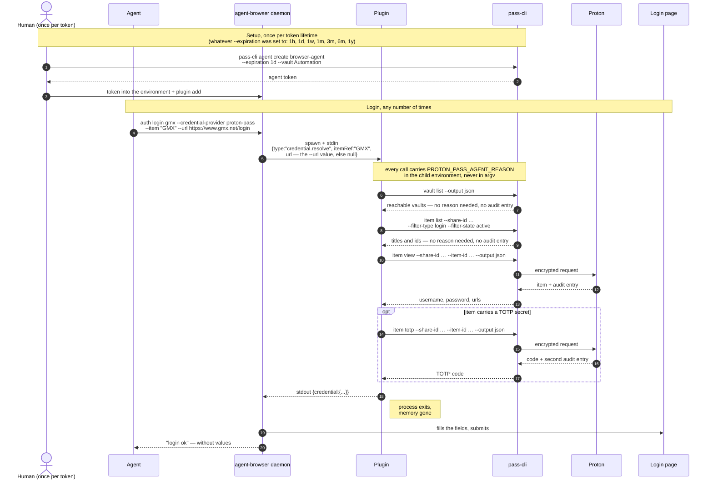
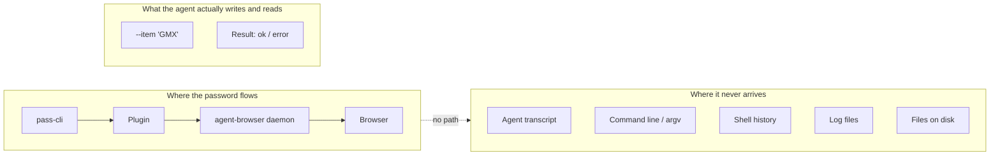

# agent-browser-plugin-proton-pass

Resolve a Proton Pass login for [agent-browser](https://github.com/vercel-labs/agent-browser) so the password reaches the browser form without ever entering the agent's transcript, `argv`, or shell history.

[](https://github.com/evrenverse/agent-browser-plugin-proton-pass/actions/workflows/ci.yml)

**Status: 0.1.0, on GitHub and not on npm.** There is no npm release: `agent-browser plugin add` resolves a reference by shape, and the `owner/repo` form it resolves from GitHub is what installs this package. The chain has been driven end to end against a real Proton Pass vault three times: 2026-08-17, 2026-08-20, and 2026-08-27/28, the last across eleven German shops with thirty-two audited credential reads, plus the first real run of `setup` — which is where its own bug surfaced. See [Security model](#security-model) for exactly which claims those checked and which are still untested.

## Unofficial

This project is **not operated by, endorsed by, or affiliated with Proton**. It is a third-party plugin that shells out to Proton's own `pass-cli`.

`pass-cli` is GPL-3.0. This package invokes it as a **subprocess** — it does not link against it, embed it, or ship it — so no copyleft obligation attaches to this MIT-licensed code. `pass-cli` itself remains under its own licence and must be installed separately.

## Quickstart

Requires Node (this package declares `>=22`; agent-browser itself requires `>=24`, so in practice you have 24) and `pass-cli` on `PATH`. **Zero runtime dependencies** — `package.json` carries no `dependencies` key, on purpose: this is a tool that touches passwords, and supply-chain surface outranks convenience.

Install it from GitHub. There is no build step and no lifecycle script, so a git install is the whole of it:

```bash
npm i -g github:evrenverse/agent-browser-plugin-proton-pass
```

```bash
# 1. A human logs in to their own Proton Pass session. Nothing below works
#    without it: with no session at all, even `vault list` answers
#    `Error: This operation requires an authenticated client`.
pass-cli login

# 2. One command for everything that follows. It lists the vaults that session
#    can see, asks which of them the agent may read — numbered, nothing
#    preselected, and an empty answer creates no token — repeats the choice back
#    with what it means, creates the scoped token, writes
#    ~/.proton-pass-agent/env (mode 0600, in a 0700 directory), logs the agent in
#    there, and ends with the `doctor` report. The token is never printed and
#    never reaches `argv`. Run it again whenever you need to — it clears the
#    agent session left by the previous run first, in that directory and no
#    other. From a checkout this is `node src/index.js setup`.
agent-browser-plugin-proton-pass setup

# 3. In every shell that will run agent-browser — the daemon's above all. The
#    file holds the agent's session directory, its key provider, and its token.
source ~/.proton-pass-agent/env

# 4. Register the plugin. `plugin add` asks it for plugin.manifest and
#    discovers the credential.read capability from the answer. It resolves a
#    reference by shape — a bare name or an `@scope/name` from npm, an
#    `owner/repo` from GitHub — and never a local path, which is why the form
#    below is the GitHub one. Add --global to write
#    ~/.agent-browser/config.json instead of ./agent-browser.json.
agent-browser plugin add evrenverse/agent-browser-plugin-proton-pass --name proton-pass

# 5. `setup` ran this once already; run it again whenever a login misbehaves.
#    Two pass-cli commands are worth knowing beside it: `pass-cli share list`,
#    which shows vaults *and* items shared with the agent directly and is
#    therefore the fuller picture of its reach than `vault list` alone, and
#    `pass-cli test`, which checks connectivity to the Proton API.
agent-browser-plugin-proton-pass doctor
```

**The one question in there that deserves thought is which vaults.** A token is scoped to whole vaults, not to single items: whatever you pick, the agent can read every login in it, for as long as the token lives. That is why `setup` preselects nothing, treats an empty answer as "none, and no token", and defaults its confirmation to no. Answering `all` grants every vault the session can see — a word rather than twenty-one numbers, because a human typing twenty-one numbers produces a typo, not a decision. It is never a default and never preselected, and the confirmation still names every vault it stands for. Aim for one vault holding only what the agent needs. If that means moving items around first, answer nothing, move them, and run `setup` again.

`setup` asks, so it needs a terminal. Without one it prints the vault list and the manual commands and exits non-zero, rather than choosing for you — see [Doing it by hand](#doing-it-by-hand), which is also the path to take when the vault question needs more than a moment.

Then, any number of times:

```bash
agent-browser open https://www.gmx.net/login
agent-browser auth login gmx --credential-provider proton-pass --item "GMX" \
  --url https://www.gmx.net/login
```

**Pass `--url`, and pass the login page.** agent-browser does not tell the plugin which page the browser is on: without `--url` the request carries `"url": null`, captured verbatim from 0.34.0. Two things follow from that null directly: the audit reason degrades from `agent-browser login: gmx (www.gmx.net)` to `agent-browser login: gmx`, because the plugin never learned a host, and an item that stores no URL either fails outright with `✗ Credential has no URL`. Two more follow whenever the item's stored URL — usually the site root — differs from the page you opened, which is the normal case: agent-browser navigates there, away from your form, and resolves a **second** time at the page it landed on, doubling the audit entries. One flag avoids all four.

### The browser is a part you can swap

agent-browser drives whatever Chromium `--executable-path` points at (or `AGENT_BROWSER_EXECUTABLE_PATH`), and **the plugin neither knows nor cares which one**. It speaks stdin and stdout; the browser is on the other side of agent-browser. That matters because the browser is where bot protection is decided, and it is the piece most likely to change.

Measured 2026-08-26 against four real German B2B shops, headless throughout, with a patched stealth Chromium in that slot: two of the four went from a challenge stub to the full page, and one of them — behind Radware Bot Manager — was logged into end to end through this plugin, with `pass-cli agent monitor` recording the read in the designed form. What made the difference was not the patched binary alone but a **consistent** fingerprint: a Linux user agent beside an NVIDIA GPU string and no Windows fonts is a contradiction, and fixing the contradiction is what opened the page. Cloudflare's managed challenge did not complete on the 58-patch free build and did on the 73-patch one, so on that vendor the patch count was the whole difference. Akamai refused at the edge before any page existed, which is an IP-layer decision no browser can argue with — in the run recorded here it was a VPN exit being refused, not the browser.

**One limitation is worth stating on its own, because it defeats the documented flow.** Cloudflare protects a login path more tightly than the pages around it. Navigating straight to `/login` drew a fresh challenge that never cleared; reaching the same page by *clicking* a link from a home page that had already cleared showed the real form. `auth login --url` navigates, so it always enters cold, and the login then fails with `✗ Timed out waiting for username selector`. Nothing in this plugin can help: agent-browser owns the navigation, and `auth login` has no mode that fills the page already open. Where a site does this, the credential path works and the flow around it does not.

None of that is this project's business, and none of it required a change here. It is recorded because the question "why does the login not work" usually has its answer one layer down.

**What was in that slot, named so the measurement can be repeated:** [CloakBrowser](https://github.com/CloakHQ/CloakBrowser), a Chromium carrying source-level patches for the fingerprinting vectors — canvas, WebGL, audio, fonts, GPU, screen, WebRTC, automation signals. The free channel is Chromium 146 with 58 patches; a free key raises that to Chromium 151 with 73, capped at one concurrent session. That difference decided one of the four sites, so the number is not cosmetic. `AGENT_BROWSER_EXECUTABLE_PATH` points agent-browser at its binary, and these flags are the ones that mattered:

```bash
export AGENT_BROWSER_EXECUTABLE_PATH="$HOME/.cloakbrowser/chromium-<version>/chrome"
export AGENT_BROWSER_ARGS="--fingerprint-platform=windows,--fingerprint-windows-font-metrics,\
--fingerprint-locale=de-DE,--fingerprint-timezone=Europe/Berlin,--fingerprint-webrtc-ip=auto"
```

The patched binary on its own bought only what plain Chromium already managed *headed*. The four flags are what took Radware from a 542-byte challenge to the full page, and `--fingerprint-windows-font-metrics` wants the actual Windows fonts present — on WSL they are one `cp /mnt/c/Windows/Fonts/*` away. Presenting as Windows while lacking Windows fonts is another contradiction, and contradictions are what gets read.

**Stated plainly, because this README is a document about handling passwords: none of the above is a recommendation.** A patched third-party browser in the slot that types your vault password is a decision about your own threat model, not a detail — it is a large binary from outside the distribution channels either Google or your OS vendor controls, and this project has no way to vouch for it. The vendor's own pass/fail table is theirs, not a measurement made here; what was measured here is the single result above, on one machine, on one day, against four sites, of which two went through.

**And the plugin requires none of it.** It resolves credentials over stdin and stdout and is spawned by agent-browser once the browser already exists — so it cannot configure a browser even in principle, and does not try. Everything in this project works identically with the Chromium agent-browser installs itself, with a hosted provider (`-p browserbase|kernel|browseruse|browserless|agentcore`), or with an iOS device. Which browser meets the bot protection is agent-browser's configuration and yours to make; it is described here and nowhere depended upon.

**On any page with more than one form, pass the selectors too.** Two real German shops, two for two: one login page carries **six forms and three password fields**, one of them literally `id="dummy"`, with `Passwort einblenden` as the first button inside the login form; the other has three forms and **two** password fields, `login_password` beside `registration_password`, behind `ANZEIGEN` and `Verbergen` buttons. This is the normal case, not an edge one, and the field a heuristic picks wrong is a registration form that would receive your vault password. Measured against agent-browser 0.35.0 on a page whose login form sat below a newsletter signup: the password went into the right password field and the **username went into the newsletter field**, leaving the login form's username empty — and `auth login` then reported `✓ Logged in as …` without submitting anything. The plugin had resolved correctly; the heuristic picked the first plausible field on the page rather than the one beside the password. `--username-selector '#user' --password-selector '#pw' --submit-selector '#submit'` fixed it completely. Two things follow: give the selectors whenever the page has a second form, and treat `✓ Logged in as` as "the fields were filled", never as "the login worked" — confirm with `agent-browser get url`.

**Give all three selectors every time, not only when the page has two forms.** Measured 2026-08-27 across eleven German shops: without `--submit-selector`, `auth login` takes the first plausible submit button on the page — and on a shop that is the search box. Two shops answered the login attempt with `Der eingegebene Suchbegriff ist leider zu kurz` and one navigated to `advanced_search_result.php`; all three reported `✓ Logged in as` while doing it. Passing `--submit-selector` fixed both cases immediately. A shop page without a search field is the exception, so treat the selectors as required arguments.

**Expect the cookie banner, not the plugin, to be what blocks the login.** In the same run it was the single most common cause of a failed login: three shops, three different consent systems (`acris-cookie-consent`, `eightworks-cookie-consent-plus`, TagCommander), each laying an overlay over the submit button. agent-browser 0.35.0 detects this and refuses the click with `is covered by <div…>` — but that refusal does not reach `auth login`'s exit status, which still says `✓ Logged in as`. Dismiss the banner before resolving anything: click its reject button, or remove the element outright. Removing it accepts nothing, which is the point. A fourth failure had no overlay at all: the submit button sat at y=586 in a 1280×599 viewport, so its click point fell below the fold and the click silently did nothing — `form.requestSubmit()` is the way out of that one.

`--item` accepts a `pass://SHARE_ID/ITEM_ID` URI, a `Vault/Title` reference, or a bare `Title`. Titles match case-insensitively, exact before partial. Omit `--item` and the plugin derives the registrable domain from the request's URL and matches that against your item titles instead — which needs `--url`, since that is the only thing that puts a URL in the request. Anything other than exactly one match is an error that **names the candidate titles** — titles are not secrets, so the agent can ask a precise question instead of guessing.

**A `pass://` URI is session-specific, and a title is not.** Share ids differ per session: the same vault carries one id under a human login and a different one under each agent token. A URI copied out of your own `pass-cli` therefore names a share the agent cannot see, and Proton refuses it — measured 2026-08-27 as a bare `Invalid status code: 422 Unprocessable Entity`, which names neither cause nor fix. The plugin now translates that 422 into the diagnosis and the two ways out: read this session's id from `pass-cli item list <vault> --output json`, or use the title, which is the same for everyone.

For interactive sessions, make each secret read require your approval. `--confirm-actions` is a global flag and goes **before** the subcommand:

```bash
agent-browser --confirm-actions plugin:proton-pass:credential.read \
  auth login gmx --credential-provider proton-pass --item "GMX" --url https://www.gmx.net/login
```

To install the agent-facing skill (the rules an agent should follow around a resolved password) into a project:

```bash
agent-browser-plugin-proton-pass skill install --agent claude   # or: --agent codex
```

`plugin add` writes the `agent-browser.json` entry for you. Write one by hand to point at a local checkout, or to reach the wrapper script below — an entry declares a name, an executable command, and its capabilities:

```json
{
  "plugins": [
    {
      "name": "proton-pass",
      "command": "node",
      "args": ["/absolute/path/to/agent-browser-plugin-proton-pass/src/index.js"],
      "capabilities": ["credential.read"]
    }
  ]
}
```

A plugin entry takes exactly `name`, `command`, `args` and `capabilities` — there is **no `env` field** (checked against agent-browser 0.34.0). The plugin inherits the daemon's environment, which is where `PROTON_PASS_PERSONAL_ACCESS_TOKEN` belongs anyway. If you do need to give the plugin an environment of its own — the agent's own `PROTON_PASS_SESSION_DIR` and `PROTON_PASS_KEY_PROVIDER`, which is now the most important reason to write one (see [Give the agent its own session directory and a filesystem key](#give-the-agent-its-own-session-directory-and-a-filesystem-key)), or `PASS_CLI_BIN` pointed at a stand-in `pass-cli` while testing — make `command` a wrapper script:

```bash
#!/usr/bin/env bash
export PROTON_PASS_SESSION_DIR="$HOME/.proton-pass-agent"
export PROTON_PASS_KEY_PROVIDER=fs
export PASS_CLI_BIN=/absolute/path/to/your/fake-pass-cli   # while testing only
exec node /absolute/path/to/agent-browser-plugin-proton-pass/src/index.js
```

and set `"command": "/absolute/path/to/wrapper.sh"` with `"args": []`. `agent-browser plugin list` then prints `proton-pass  credential.read` — but that line is the entry you just wrote, echoed back. `plugin list` never spawns the plugin (checked against 0.34.0: the line stays green even when the command answers with nothing usable), and neither does `plugin show`. A green `plugin list` confirms the config parses, and nothing more.

The same applies to every command spelled `agent-browser-plugin-proton-pass …` below, including `setup`, `doctor` and `skill install`: the executable is only on `PATH` once the package is installed. From a checkout, run `node src/index.js setup`, `node src/index.js doctor` and `node src/index.js skill install` instead.

### Doing it by hand

`setup` automates the sequence below, plus a `pass-cli --version` check and — on a re-run — the `logout --force` that step 4 explains. It is worth running by hand when the answer to "which vaults" needs looking into, reading what is in them first or creating one for the purpose, and it is the only path without a terminal.

```bash
# 1. Find out what your vaults are actually called. --vault takes an existing
#    name, exactly as spelled; anything else fails with
#    `Error: Failed to find vault: <name>`. "Automation" below is a throwaway,
#    not a name you have.
pass-cli vault list

# 2. Create the scoped agent token. --vault can be repeated, and every vault
#    named is one the agent can read every login in.
#    --expiration is required and takes one of 1h, 1d, 1w, 1m, 3m, 6m, 1y.
#    It is a real trade-off, not a formality: when the token dies a human has to
#    renew it and re-export it, so 1h means doing this every hour. Pick the
#    shortest span you can stand, not the shortest one on the list.
#    The answer is JSON: the token is its `token` field, and Proton's own
#    instructions follow it as prose.
pass-cli agent create browser-agent --expiration 1d --vault Automation

# 3. The token goes into the environment the agent-browser daemon inherits,
#    together with pass-cli state of the agent's own: a session directory it
#    does not share, and a key that does not live in a login session's keyring.
#    See "Platform notes" — without this an agent under a daemon cannot decrypt
#    the local database at all. From here on this shell is the agent's, not
#    yours: it no longer sees the session your own `pass-cli login` created.
export PROTON_PASS_SESSION_DIR="$HOME/.proton-pass-agent"
export PROTON_PASS_KEY_PROVIDER=fs
export PROTON_PASS_PERSONAL_ACCESS_TOKEN='<the token it printed>'

# 4. Log the agent in, in that same shell. Exporting the token is NOT enough: on
#    its own every command still answers `Error: This operation requires an
#    authenticated client`. This writes the agent's session into the directory
#    above, next to no one else's.
#
#    Doing this a second time — a new token, a different vault, another machine
#    — fails with `Error: Already authenticated`, because that directory now
#    holds a session. Clear it first, and only ever in a shell where
#    PROTON_PASS_SESSION_DIR is already exported: `--force` does not ask, and
#    without the export the same command wipes your own session instead.
pass-cli logout --force   # on a re-run only, and only with the export above set
pass-cli login
```

Step 4 is not this project's invention: `pass-cli agent create` prints Proton's own agent instructions next to the token, and they prescribe the same two steps — a session directory of the agent's own, then `pass-cli login` with the token in the environment. The isolated `PROTON_PASS_SESSION_DIR` this project arrived at by measurement (see [Platform notes](#platform-notes)) is what Proton recommends independently.

If you are creating a throwaway login item for a first test: a Proton **organisation policy can reject `--generate-password`** outright — one seen in practice is `Your organization requires random passwords to be at least 32 characters long`. Raise the length rather than fighting it. The flag is `--generate-password[=<SETTINGS>]` and its settings string is `length,uppercase,symbols`, where the last two are literal words and not booleans: `--generate-password=40,uppercase,symbols`, not `=40,true,true`.

## How it works



Discovery is free: `vault list` and `item list` need no reason and leave no audit entry. Only `item view` and `item totp` are audited, which is what keeps the cost at **one audit entry per login, or two when 2FA is involved** — plus one more on a login that re-authenticates *and* dies on an audited call, the third case below. A `pass://` URI in `--item` skips discovery altogether and goes straight to `item view`.

**The caveat that count depends on: `--url`.** agent-browser navigates to the `url` the credential carries and resolves *again* at the page it lands on. The plugin returns the URL from the request — which only `--url` puts there — and falls back to the item's stored URL otherwise. So: **with `--url`, one audit entry per login, two with 2FA. Without it, and with a stored item URL that differs from the current page, double that** — two entries, four with 2FA. Measured against agent-browser 0.34.0 with a stand-in `pass-cli`, counting invocations: one `credential.resolve` when the URLs agree, two when they differ.

### A session gone from under a live token, and what the plugin does about it

`pass-cli`'s session can stop working while the token that created it still has days to run. Measured on 2026-08-18: an agent token made with `--expiration 1w`, eleven hours old, five days of life left — and every `pass-cli` call in the agent's session answering `failed to authenticate: non-existent session`. The token was valid; the session was gone. Three commands in the agent's own session directory brought it back, with the token that was already sitting in that session's environment the whole time:

```bash
pass-cli logout --force   # "Successfully performed force logout"
pass-cli login            # with PROTON_PASS_PERSONAL_ACCESS_TOKEN exported
pass-cli info             # "[Agent] browser-agent" — back
```

This is not exotic, and it is not this project's discovery: the agent instructions `pass-cli agent create` prints beside the token carry a section headed **"Auto-recovery from logout"** prescribing exactly that, for *any* authentication error. **The plugin now does it itself** — one `logout --force`, one `login`, then the call that failed, retried once. An agent left running overnight keeps working instead of stopping at an error nobody is awake to read.

**Two states, one remedy.** `pass-cli` spells them differently and the plugin heals both:

| What you would have seen | When |
| --- | --- |
| `pass-cli failed: failed to authenticate: non-existent session` | The session died under a token still days from expiring — the measurement above |
| `Not logged in to Proton Pass. Ask a human to run: pass-cli login` (`pass-cli`: `This operation requires an authenticated client`, `there is no session`) | No session was ever made in that directory: after a clean `logout --force`, on a second machine where someone sourced `~/.proton-pass-agent/env` and never ran `pass-cli login`, or in the window inside `setup` between writing that file and logging in |

The second is at least as reachable as the first, and in both the token is sitting right there.

What it costs and what it needs, stated plainly:

- **One extra audit entry — but only when the call that died was an audited one.** The retried `item view` is a second read and is logged as such, which is correct and wanted: the read really did happen twice. The common case costs nothing, because the call that dies is usually the first one, `vault list`, which is not audited; the recovery then repairs the session before the login is ever read. Whether Proton files a monitor event for the `pass-cli login` itself is **unverified** — the agent monitor was not inspected across a recovery, and `pass-cli` documents no such event.
- **Every audited call after a recovery carries `[re-authenticated]` in front of its reason**, so `pass-cli agent monitor` reads `[re-authenticated] agent-browser login: gmx (www.gmx.net)` rather than showing an unexplained second read. A self-healed session is a security-relevant event, and the audit log is the one channel that can carry it: stderr stays empty on every path (a merge-gating test) and stdout is the protocol.
- **`PROTON_PASS_PERSONAL_ACCESS_TOKEN` must be in the environment the plugin inherits** — that variable is not only for the first login. Without it there is nothing to log in with, and the original error stands unchanged.
- **`PROTON_PASS_SESSION_DIR` must be too.** `logout --force` destroys a session and does not ask, so it may only ever run against the agent's own directory; with the variable unset `pass-cli` uses its default one, which is yours. The plugin does not fire at all in that case.
- **Once per request.** A login makes up to four `pass-cli` calls and `doctor` three; one dead session costs one recovery, not one per call. If the retry fails, the caller gets the original failure and nothing else.
- **Only on a failure to authenticate**, never on the undecryptable local database: no login can reach a key the process cannot see, and that failure has its own answer below.
- **A call can opt out.** `setup` asks `pass-cli info` whether the agent's directory already holds a session and reads the failure as the answer "no"; a probe that healed itself would answer its own question wrong. That exclusion is a flag on the call, not a gap in the matcher, so it is visible where it applies and no other caller inherits it.



The agent composes the command with an *item name*, so a name is all its transcript can ever contain. The value appears two processes away, over a pipe the agent does not hold.

## Security model

### Guaranteed

- The password never appears in `argv`, shell history, the agent transcript, or any file the plugin writes. The audit reason travels in the child's environment, never as an argument — `argv` is world-readable through `/proc` on Linux.
- The plugin writes **no secret to stderr on any path**, including error and debug paths. This is a test, not an intention: `test/no-secret-leak.test.js` drives ten paths through the plugin the way agent-browser does. On four of them a sentinel secret is genuinely in play — the success path, a failure that strikes after the value was already resolved, a malformed request carrying the sentinel in its own bytes, and a resolve that re-authenticates midway — and the test fails if the sentinel appears where it should not. The other six abort before `item view`, so no sentinel exists yet; there the test asserts something stricter, namely that stderr is empty altogether, which also catches a stack trace or stray debug output. The last of those six is the answer nobody is left to read: agent-browser can be gone by the time the response is written — killed, timed out, or a daemon restarted while up to four `pass-cli` calls were in flight — and the write then raises `EPIPE`, whose Node default is a full stack trace on exactly the stream this claim is about. The plugin drops the answer in silence instead. It runs in `npm test`, and the CI workflow runs `npm test` on every push to `main` and every pull request — once the repository is published, CI enforces it.
- A parsed item without a password is an error, never an empty credential — so schema drift cannot make agent-browser type an empty password into a form.
- **A credential is refused for a site the item was not stored for.** The request's `url` — the `--url` value, and the one part of the request an agent composes freely — is compared by registrable domain against the item's own stored `urls` before anything is handed back, and a mismatch is an error naming both sides. Without that check, naming a real item and pointing `--url` at another host had the vault password and TOTP typed into a page of the agent's choosing: the value never entered the transcript, so every claim above still held, and the password was gone anyway. `test/credential.test.js` covers the refusal, a login page on a subdomain of the item's site (allowed — the comparison is per site, not per host), and the `pass://` path, which skips discovery and would otherwise be the one unbound route. **Measured against a real vault on 2026-08-20**, under a token scoped to one vault of an account holding 21: a resolve naming a real item and aiming `--url` at a host that item does not store was refused, while the same item resolved for its own site and for a subdomain of it — so the check stops the exfiltration without costing a legitimate login, which is the half no fixture can settle. The same run showed a property the check was not designed for and now keeps: **a refused resolve is audited, and the entry names the host it was aimed at** — `reason="agent-browser login: probe (<the foreign host>)"`. The block is not silent, and an operator reading `pass-cli agent monitor` sees which destination an agent tried to send a credential to. A refused login still costs the one `item view` audit entry, and cannot cost less: `ItemSummary` — what `item list` returns — carries titles and ids and no URL, so the item's own URLs are not knowable until the read that the check then rejects the result of. It never costs the second entry, because `item totp` comes after. **The residual is stated in the next list:** an item that stores no URL is bound to nothing.
- The agent token reaches only granted vaults, and bulk export (`item list --show-secrets`) stays blocked for agent sessions. Checked against a real account on 2026-08-17: with twenty vaults on the account and the token scoped to one, `pass-cli vault list` under that token returned exactly that one. The other nineteen were invisible to it.
- Every audited read carries a reason into Proton's end-to-end-encrypted audit log, readable afterwards with `pass-cli agent monitor`. The form is `agent-browser login: <profile> (<host>)`, and truncation to `pass-cli`'s 300-character cap shortens the profile rather than dropping the host: the host survives intact up to 276 characters — comfortably past the 253 a DNS name can have — and only one longer than that loses its own tail. `test/reason.test.js` pins both ends: a 400-character profile truncated with the host still attached, and an over-long host clamped to the cap with an ellipsis. Without `--url` there is no host to name at all, because agent-browser sends the plugin `"url": null`, and the reason degrades to `agent-browser login: <profile>`. The host is the one datum an auditor cannot reconstruct afterwards, which is the third reason to pass `--url`. Checked against a real account and a real audit log on 2026-08-17: one login produced exactly one entry, `2026-08-17 22:14:38 action=ItemRead vault="Automation" item="Probe" reason="agent-browser login: probe (127.0.0.1)"`, and a second login under another profile name added exactly one more, carrying `reason="agent-browser login: probe2 (127.0.0.1)"`. That item held no TOTP; the two-entries-with-2FA half was measured separately on **2026-08-20**, against a real login item with 2FA on the same `pass-cli` 2.3.2 — one `ItemRead` for `item view`, one for `item totp`, exactly the two the design predicts. The same run showed that `item totp` **enforces** `PROTON_PASS_AGENT_REASON` too, not just `item view`: without it the call refuses with `Agent sessions must set the PROTON_PASS_AGENT_REASON environment variable before running item commands.`
- agent-browser does not persist plugin-resolved credentials. Its documentation states they are "resolved just-in-time and are not saved locally", and this was checked against agent-browser 0.34.0 rather than taken on trust: after a successful plugin login, `agent-browser auth list` printed `No auth profiles saved`, `agent-browser auth show <name>` reported the profile as not found, and a sentinel password appeared nowhere under `~/.agent-browser`. Repeated on 2026-08-17 with a **real** 40-character vault password rather than a sentinel: zero hits under `~/.agent-browser`, zero in the agent's `PROTON_PASS_SESSION_DIR`, zero in `~/.zsh_history` and `~/.bash_history`, zero in the test server's log, and none in any live process's `argv` at the time of the sweep across `/proc/*/cmdline`. The one place it appeared was the form submission, which is the destination. One version, checked twice — not a promise about future ones.

Where each of those comes from, since they do not share a source:

- **Vault scoping, blocked bulk export, and the audit log itself** are `pass-cli`'s properties, not this plugin's. They were read from the `pass-cli` source and cited line by line while this was designed — `item/view.rs` for the cleartext read and its audit call, `item/list.rs` for the blocked `--show-secrets`, `agent_monitor.rs` for the enforced reason — and this plugin relies on them rather than reimplementing them.
- **The reason format, its truncation rule, and the degradation without `--url`** are this plugin's own behaviour: `src/reason.js`, covered by `test/reason.test.js`.
- **Non-persistence** is agent-browser's property, stated in its documentation and additionally observed against 0.34.0 as described above.

**What the tests show, and what they do not.** The leak test drives the plugin against a *fake* `pass-cli`, so it proves what the plugin's own streams carry on each path, and nothing about a real vault.

Beyond the tests, the whole chain was run once against a real Proton Pass account on **2026-08-17** — `pass-cli` 2.3.2, agent-browser 0.34.0, one Linux/WSL machine — with a throwaway vault, one login item without TOTP, and a single-page form on localhost. What that checked:

- The login itself: `auth login … --credential-provider proton-pass --item "Probe" --url …` printed `✓ Logged in as 'probe'`, and the form received the real username and the real 40-character password from the vault.
- **The audit trail**, the spec's central claim, read back from `pass-cli agent monitor`: one `ItemRead` entry per login, carrying the reason in the designed form, with the host present. Quoted in full [above](#guaranteed).
- **Token scoping**, against an account with twenty vaults: the scoped token saw one.
- **No leak of the real secret**, searched for across `~/.agent-browser`, the session directory, both shell histories, the test server's log, and every `/proc/*/cmdline` — the last of those point-in-time, and weaker than it sounds: once the login has completed, any process that had held the value in `argv` has exited, so the sweep can only fail to contradict the guarantee. What establishes it is the code and `test/no-secret-leak.test.js`.
- `doctor` against a real agent session: every check as documented, `--json` reporting `ok: true`.
- The ambiguity error against a real vault: an unknown `--item` produced the message [documented under Troubleshooting](#troubleshooting), listing the vault's one real login title as the candidate — the throwaway vault held exactly one, so the message's behaviour with several is still only covered by `test/resolver.test.js`.

What that run did **not** cover, and what therefore still rests on the tests alone: **a real site's login form** — the form was one page on localhost, so agent-browser's selector heuristic has still only been tried against markup written for the test, and nothing here says anything about a multi-step flow; every platform other than the one Linux/WSL machine it ran on; and **`setup` as a whole**, which was written after that run and has never been driven end to end against a real account. The 2026-08-20 run established why it cannot be, from an agent process: `setup` reaches the *human's* session to list vaults and mint a token, and on the machine both runs used that session's database key lives in a keyring the agent process cannot read — so `setup` stopped at its first call, correctly, without asking a question or creating anything. Driving it end to end needs a human at their own terminal, which is what the command is for. Its three uncertain `pass-cli` calls were measured separately on 2026-08-17, and one of them found a defect: `agent create` answers with a JSON object of exactly `token` and `instruction`, the token prefixed `pst_`; `pass-cli login` works spawned through `execFile` with the token in the child environment; and it **refuses a session directory that already holds a session** — `Error: Already authenticated`, exit 1 — which would have made every second `setup` run fail after minting a token. `setup` now clears the agent's own stale session first. What the suite still cannot show is any of that against a real vault.

One gap was structural rather than unfinished: **the `plugin.manifest` handler had no caller to answer.** `plugin add` is the only agent-browser command that asks a plugin for its manifest, and it resolves a reference by shape — npm for a bare name or an `@scope/name`, GitHub for an `owner/repo` — never a local path, while `plugin list` and `plugin show` echo the configured entry without spawning anything. Publishing the repository is what supplies the caller, and `agent-browser plugin add evrenverse/agent-browser-plugin-proton-pass` is the check. Until someone has run it, that handler is exercised only by `test/manifest.test.js`.

### Not guaranteed, and stated as plainly

- **This is not a sandbox.** An agent with shell access and the same session can call `pass-cli item view` itself and read the value. The plugin is the convenient path, made accountable by scoping and audit — not a wall. Hard separation needs a separate user context.
- **An item that stores no URL can be resolved for any site.** The check above needs something to compare against, and the vault is where that record lives. This is not an oversight: it is the flow the README documents for an item saved without a URL, where `--url` is the only URL there is. Give an item a URL and it is bound; leave it without one and the destination is whatever the login asked for. A multi-part public suffix weakens the check the same way — `registrableDomain` reduces `a.co.uk` and `b.co.uk` alike to `co.uk` — so two unrelated sites under one of those compare equal. Neither case can refuse a legitimate login; both can fail to refuse an illegitimate one.
- **Once the password is in the browser, it is in the DOM.** `get value`, `get html`, `snapshot`, or a screenshot can surface it. The bundled skill forbids those against password fields after a login; nothing enforces it.
- **`pass-cli run` masks streams, not files.** Its masking only covers values it resolved from a `pass://` reference, and only when they are at least five characters long. Screenshots, HAR captures, and anything a child writes to a file stay unmasked.
- **`setup` writes an agent token to disk, because something has to.** `~/.proton-pass-agent/env` is the one file this project creates: mode 0600 in a 0700 directory, written only after you have been asked, and never overwritten without a second question. The token never reaches `argv`, the terminal, or shell history — but it is a credential in a file, readable by root and by anything else running as you, and a daemon that sources it carries it in an environment readable through `/proc/<pid>/environ`. It is scoped to the vaults you chose and it expires; those are what limit it, not the file's mode.
- **Remaining token lifetime is not visible.** `pass-cli info` exposes no expiry for the current session, so neither `doctor` nor the plugin can warn you ahead of time. An expired token surfaces on the first login attempt after it dies.
- **An unrecognised `pass-cli` failure is relayed to the agent almost unaltered.** The `pass-cli failed: …` message carries a line of `pass-cli`'s own stderr into the protocol `error` field, which is where the agent reads it. The only thing removed on the way is ANSI escape sequences — `pass-cli` colours its stderr even when stderr is not a terminal. Beyond that, a `trim()`, and the choice of which line to relay (see the `pass-cli failed:` row under [Troubleshooting](#troubleshooting)), the line is passed on as it came: it is matched against the five failure signatures the plugin knows how to explain, but never sanitised, redacted, or scanned for anything that might be a value. `pass-cli` prints values on stdout and diagnostics on stderr, so no known error path carries a secret — but if one ever did, it would reach the agent. `test/no-secret-leak.test.js` scans stderr, not the protocol error, so this is not a case the merge gate would catch. The detail is kept because it is the only thing a human has to go on when nothing else matched, and a sanitiser here would have to guess what a secret looks like.

## Multi-step logins

`auth login` waits for the username and password selectors on **one** page, so a two-stage flow (email → Next → password) times out with it. That is a limit of `auth login`, not of this plugin — see the stdin route below, which does solve it. The fallback `pass-cli` documents:

```bash
pass-cli run --env-file secrets.env -- bash -c 'agent-browser fill "#pw" "$PW"'
```

**Superseded 2026-08-26, and by something strictly better.** `agent-browser batch` reads its commands from **stdin**, so a value can travel from this plugin into a form without ever becoming an argument — and without the navigation that `auth login` performs unconditionally. That covers two-stage flows, and it covers the login paths where a reload would lose a dismissed banner or a passed challenge:

```bash
agent-browser open https://example.com/login
agent-browser fill '#username' 'the.user@example.com'   # a username is not a secret
# submit step one, then, once the password field exists:
agent-browser-plugin-proton-pass fill-commands --item "GMX" --password-selector '#pw' \
  | agent-browser batch
```

Measured on 2026-08-26 against a real two-stage shop login: the password arrived in the field and the login completed, with the value in no `argv` at any point. Use plain `batch`, never `batch --json`, which echoes each command back to stdout including the value. The full recipe is in the bundled skill.

The older fallback below is kept because it is what `pass-cli` itself offers, and because it is the only path when the value must reach a program other than the browser. It is the weaker of the two.

A human writes `secrets.env` ahead of time and it holds `pass://` references, never values — e.g. `PW=pass://SHARE_ID/ITEM_ID/password`. The single quotes are mandatory: `$PW` must expand inside the child, not in the agent's shell. The agent writes `$PW` and never a value.

The residual risk, plainly: `bash` expands `$PW` before `exec`, so the value **is** in that `agent-browser fill` process's `argv` and readable from `/proc/<pid>/cmdline` for as long as it runs. `pass-cli run` masks the child's stdout and stderr, but it does not mask files — a screenshot or a HAR capture taken while the field is filled contains the password. This fallback is a step down in safety from the plugin path; use it only where the plugin path cannot work.

## Platform notes

`pass-cli` talks to Proton's servers directly and needs no local daemon, which is why there is no cross-boundary problem here.

**Windows is untested, and CI does not claim otherwise.** The suite runs on Linux and macOS only. The reason is a decision made elsewhere in this package: `pass-cli` is spawned without `shell: true`, because putting a shell between this code and a password manager is an injection surface. Node has refused to spawn a `.cmd` without a shell since its CVE-2024-27980 fix, and on Windows the test harness's fake `pass-cli` can only be a `.cmd` — so the suite cannot run there without weakening the property it exists to protect. Nothing here is known to break on Windows; it has simply never been measured, and a green badge for a platform nobody has run would be worse than this paragraph.

| Environment | Behaviour |
| --- | --- |
| Linux, macOS | Keyring present, unremarkable — as long as the agent runs in the login session that logged in. When it does not, see below |
| WSL | As Linux, D-Bus or no D-Bus: nothing falls back to file storage on its own, so the key provider is a decision you make (see below). Web login opens the *Windows* browser via `powershell.exe … Start-Process` — it works, but it surprises people |
| Windows native | Works wherever Node is present |
| Proton Pass desktop on Windows, agent in WSL | Irrelevant. Install `pass-cli` **inside** WSL; the desktop app is never involved |

### Give the agent its own session directory and a filesystem key

`pass-cli` keeps an encrypted local cache — `pass-cli.db` (SQLCipher), `session.json`, `user_keys.enc`, `passphrases.enc` — under its session directory, and every invocation is a fresh process that must fetch the database key before it can read any of it. Four variables decide where that state and that key live, and a fifth decides whose session it is:

| Variable | What it does |
| --- | --- |
| `PROTON_PASS_PERSONAL_ACCESS_TOKEN` | The agent token. **Not only for the first `pass-cli login`:** the plugin reads it from its own environment again whenever it finds the session dead under a token that is still valid, and logs itself back in — see [A session gone from under a live token](#a-session-gone-from-under-a-live-token-and-what-the-plugin-does-about-it). Keep it exported wherever agent-browser runs, not just in the shell that set the agent up |
| `PROTON_PASS_SESSION_DIR` | The directory holding the encrypted cache. Default: the platform data directory — `~/.local/share/proton-pass-cli` on Linux |
| `PROTON_PASS_KEY_PROVIDER` | Where the database key comes from: `fs` (a 32-byte `local.key`, mode 0600, beside the database), `keyring` (the OS keyring — the default when the variable is unset), or `env` (from `PROTON_PASS_ENCRYPTION_KEY`). Anything else is rejected outright: `Invalid PROTON_PASS_KEY_PROVIDER value: 'file'. Valid values are 'fs', 'keyring', or 'env'` |
| `PROTON_PASS_LINUX_KEYRING` | Which backend `keyring` means on Linux: `dbus` (the D-Bus Secret Service, persistent) or `kernel` (kernel keyutils, cleared on reboot). `pass-cli` links both and falls back to kernel keyutils when the variable is unset or holds a value it cannot parse |
| `PROTON_PASS_ENCRYPTION_KEY` | The key itself, for `PROTON_PASS_KEY_PROVIDER=env` |

**A keyring key belongs to the login session that created it, and may not be reachable from another.** That is the failure to plan for: `pass-cli` works from the human's terminal and fails from an agent started under a daemon, because the daemon is a different login session and the key was not visible there. `pass-cli` then generates a new local key, tries the human's database with it, and reports:

```
ERROR CORE sqlcipher_page_cipher: hmac check failed for pgno=1
Error: Error creating client features

Caused by:
    …
    3: Failed to open encrypted database: file is not a database. The encryption key may not match or the
       database may be corrupted. Try running 'pass-cli logout --force' to reset local state.
```

Having D-Bus does not save you. Measured on one machine, with `pass-cli` 2.3.2: `DBUS_SESSION_BUS_ADDRESS` was set the whole time, the keys were in the kernel keyring instead (`/proc/keys`, as `keyring:cli-local-key:<fingerprint>@ProtonPassCLI` owned by the user), two of the human's terminals worked, and every call from the daemon session failed. Several such keys had accumulated. The kernel keyring is the backend that was measured; a running D-Bus Secret Service is per-user and persistent, so it may well behave differently.

**Corrected 2026-08-26 — this failure is not always read-only, and the correction cost a real session.** What was measured on 2026-08-16 was `vault list`: the SHA-256 of all four session files came out identical and the key count did not change. That held, for that command. It does not generalise. Run against a session directory whose key it cannot reach, `pass-cli agent create` answers

```
Error: Local encryption key not found but local data exists. Forcing logout for security.
Executing force logout
```

and the session is gone — database, `session.json`, `user_keys.enc`, `passphrases.enc`, and the keyring entries with them. Nothing in the vault is lost, because the local database is only a cache; what is lost is the login, and it takes a fresh `pass-cli login` to get back. A process in the wrong session can therefore destroy the human's local state, which is the opposite of what this paragraph claimed for ten days.

**And the key is not merely unreachable from elsewhere — it evaporates.** Measured 2026-08-26 on the same machine: a key visible in `/proc/keys` one command was gone the next, with the encrypted database still on disk, and no D-Bus Secret Service on the bus for `keyring` to mean anything else. Kernel keyutils keys belong to the session that created them and die with it, which under WSL is constantly. So the recommendation below is not only for the agent: **a human on Linux without a Secret Service wants `PROTON_PASS_KEY_PROVIDER=fs` for their own session too**, or every so often a command of their own will force-log them out. `setup` now warns before it touches a session in that state, and refuses without a terminal to ask.

The setup to give a browser agent — the pair `setup` writes into `~/.proton-pass-agent/env`, beside the token:

```bash
export PROTON_PASS_SESSION_DIR="$HOME/.proton-pass-agent"
export PROTON_PASS_KEY_PROVIDER=fs
```

That is a directory with no session in it yet, so the agent logs in once of its own — `pass-cli login` **with `PROTON_PASS_PERSONAL_ACCESS_TOKEN` already exported**, since exporting the token alone establishes nothing and leaves every command answering `Error: This operation requires an authenticated client` — and never shares local state with the human's terminal. Proton prescribes the same pair: the agent instructions `pass-cli agent create` prints beside the token set an isolated `PROTON_PASS_SESSION_DIR` and then run `pass-cli login` with the token in the environment. The recommendation this section arrived at by measurement is the vendor's own. If the directory already holds state written under a keyring, clear it first with `pass-cli logout --force` — **in a shell where `PROTON_PASS_SESSION_DIR` is already exported.** Without that export the same command wipes the human's working session instead, and `--force` does not ask.

The trade-off, stated plainly: `fs` puts the database key in a file beside the database it decrypts — mode 0600, and weaker than a keyring that works. It is strictly better than a keyring the process cannot reach. `env` with `PROTON_PASS_ENCRYPTION_KEY` is the stronger option wherever the caller can supply the key: `pass-cli` then stores no key of its own. It does not make the key vanish, though — something has to export it, in practice a wrapper script, which is a file — and for as long as a `pass-cli` process runs the value sits in its environment, readable through `/proc/<pid>/environ` by the same user, though not world-readable the way `argv` is.

**Nothing of this reaches the plugin by itself.** `agent-browser.json` has no `env` field, so these variables arrive only if the agent-browser daemon was started with them in its environment, or if the plugin entry's `command` points at a wrapper script that exports them — the wrapper described under [Quickstart](#quickstart), for which this is the third and most important reason.

`doctor` reports the effective key provider on every platform: `✓` for `fs` or `env`, `!` for a keyring or for a value `pass-cli` does not accept, and `✗` when a `pass-cli` call already failed to decrypt the database — proof rather than inference, so it outranks whatever the environment says.

## Troubleshooting

Start with `doctor`. What a correctly set up agent session looks like — a scoped token, an isolated session directory, a filesystem key — measured on 2026-08-17:

```console
$ node src/index.js doctor          # from a checkout; `agent-browser-plugin-proton-pass doctor` once installed
✓ pass-cli: Proton Pass CLI 2.3.2 (ac04625)
✓ vault access: Automation
✓ session kind: token session "[Agent] browser-agent" — renew with: pass-cli agent renew 'browser-agent' --expiration 1h — --expiration also accepts 1d, 1w, 1m, 3m, 6m, 1y
! telemetry: enabled — set PROTON_PASS_DISABLE_TELEMETRY=1 to turn it off
✓ key provider: fs — key in a 0600 file beside the database, independent of any login session
$ echo $?
0
```

That block is assembled rather than a single paste: the four other lines are from the run, and the `session kind` line is the current wording, which the run itself is what produced — it emitted a `pass-cli agent renew` command that could not be pasted, and that defect is fixed above. The prompt is the checkout form for the same reason, since the executable is only on `PATH` once the package is installed.

That is what passing looks like, warning included: `ok` goes false on a `✗` and never on a `!`, so a run with the telemetry warning still exits 0 and still reports `"ok": true`. Two details of the `session kind` line are deliberate. `pass-cli info` reports the token's *display* name, `[Agent] browser-agent`, but `agent renew` takes the bare `browser-agent` — so the line names the first and hands you the second, quoted. And the command **ends at the second em dash**, the one before `--expiration also accepts`: everything from `pass-cli` up to it can be pasted at a prompt as it stands, which a trailing `(or 1d, …)` inside the command would have broken.

For contrast, the same machine with `pass-cli` installed but no Proton session yet:

```console
$ agent-browser-plugin-proton-pass doctor
✓ pass-cli: Proton Pass CLI 2.3.2 (ac04625)
✗ vault access: Not logged in to Proton Pass. Ask a human to run: pass-cli login
✗ session kind: Not logged in to Proton Pass. Ask a human to run: pass-cli login
! telemetry: enabled — set PROTON_PASS_DISABLE_TELEMETRY=1 to turn it off
! key provider: keyring (PROTON_PASS_KEY_PROVIDER unset — pass-cli's default) — a keyring key belongs to the login session that created it and may not be reachable from another (measured on Linux with the kernel keyring), leaving an agent unable to decrypt the database. Set PROTON_PASS_KEY_PROVIDER=fs and give the agent its own PROTON_PASS_SESSION_DIR.
$ echo $?
1
```

`✓` passed, `!` a warning, `✗` a failure. The exit code is 1 if any check failed; warnings do not fail the run.

| Check | `✓` means | A warning or failure means |
| --- | --- | --- |
| `pass-cli` | found; the detail is its `--version` output | `✗` `pass-cli --version` did not succeed — not on `PATH`, or it exited non-zero or timed out. The detail names which. Install it, or set `PASS_CLI_BIN` to its path. Doctor stops here — nothing further can be checked |
| `vault access` | the detail names the reachable vaults | `✗` no vault reachable. Grant one: `pass-cli agent access grant`. Any other `pass-cli` failure surfaces here as its message instead — `Not logged in to Proton Pass …` when there is no session at all, or the `agent renew` line when the token has expired. For the fuller picture of what the token can reach, `pass-cli share list` adds the items shared with it directly, which a vault listing does not show |
| `session kind` | a token session; the detail names the exact `pass-cli agent renew` command for it, ready to paste — see the note under the passing example above for why the name in the command differs from the one in the prose | `!` a personal session: unscoped, unaudited, and `--show-secrets` stays permitted. Create an agent token. `✗` `pass-cli info` failed outright — with no session, both this and `vault access` carry the same `Not logged in` message |
| `telemetry` | `PROTON_PASS_DISABLE_TELEMETRY` is set | `!` not set. Set it to `1` to turn telemetry off |
| `key provider` | `PROTON_PASS_KEY_PROVIDER` is `fs` or `env` — neither depends on a login session | `!` a keyring, which is also what an unset variable means: the key belongs to the login session that created it and may not be reachable from another. `!` also for a value `pass-cli` does not accept, such as `file` or a miscased `FS`, which it rejects on startup rather than falling back. `✗` a `pass-cli` call above already failed to decrypt the local database — no longer a guess. All of them name the fix: `PROTON_PASS_KEY_PROVIDER=fs` plus a `PROTON_PASS_SESSION_DIR` of the agent's own, and `pass-cli logout --force` — in a shell with that `PROTON_PASS_SESSION_DIR` exported — before logging in again. See [Give the agent its own session directory and a filesystem key](#give-the-agent-its-own-session-directory-and-a-filesystem-key) |
| `session recovery` | absent — nothing needed repairing during the run | `!` the session was gone when the run started and `pass-cli logout --force` + `pass-cli login` rebuilt it, so the checks above describe the session doctor produced rather than the one you had. Never a `✗`: a repaired session is a working one, and the run still exits 0. It is the only place a recovery inside `doctor` is recorded — `doctor` files no audit reason, so the `[re-authenticated]` marker cannot carry it. Expect it after a reboot or a long-running agent; if it repeats, something is clearing the session |

Agents should read the machine-readable form instead of parsing prose — `doctor --json` emits the same report as `{checks, ok}`:

```console
$ agent-browser-plugin-proton-pass doctor --json
{
  "checks": [
    {
      "name": "pass-cli",
      "status": "ok",
      "detail": "Proton Pass CLI 2.3.2 (ac04625)"
    },
    {
      "name": "vault access",
      "status": "fail",
      "detail": "Not logged in to Proton Pass. Ask a human to run: pass-cli login"
    },
    {
      "name": "session kind",
      "status": "fail",
      "detail": "Not logged in to Proton Pass. Ask a human to run: pass-cli login"
    },
    {
      "name": "telemetry",
      "status": "warn",
      "detail": "enabled — set PROTON_PASS_DISABLE_TELEMETRY=1 to turn it off"
    },
    {
      "name": "key provider",
      "status": "warn",
      "detail": "keyring (PROTON_PASS_KEY_PROVIDER unset — pass-cli's default) — a keyring key belongs to the login session that created it and may not be reachable from another (measured on Linux with the kernel keyring), leaving an agent unable to decrypt the database. Set PROTON_PASS_KEY_PROVIDER=fs and give the agent its own PROTON_PASS_SESSION_DIR."
    }
  ],
  "ok": false
}
```

Failures during a login come back as `{"success": false, "error": "…"}` with **exit code 0** — a protocol-level failure, not a crash.

**Measured 2026-08-26, and read this before the table: agent-browser 0.35.0 shows none of these messages.** Every one of them reaches the operator as `✗ Plugin 'proton-pass' returned success=false` and nothing more — the `error` field is discarded, and so is anything the plugin writes to stderr (checked with a stand-in plugin writing a marker there). So the table below is what you see when you run the plugin by hand — `echo '{…}' | agent-browser-plugin-proton-pass` — or what `doctor` tells you, not what an agent reads during a login. When a login fails with that one generic line, resolving the item by hand is the way to find out why. The messages are kept in full because that is the diagnosis path, and because the situation is agent-browser's to change.

The messages, in full:

| Message | What to do |
| --- | --- |
| `pass-cli was not found. Install it from https://proton.me/download/pass-cli/install.sh or set PASS_CLI_BIN to its path.` | Install `pass-cli`, or point `PASS_CLI_BIN` at it |
| `Not logged in to Proton Pass. Ask a human to run: pass-cli login` | No session at all — the second of the two states under [A session gone from under a live token](#a-session-gone-from-under-a-live-token-and-what-the-plugin-does-about-it), so the plugin logs itself in and retries first. Reaching you means it could not: the same three causes as the row below. Otherwise a human logs in |
| `The Proton Pass agent token has expired. Ask a human to run: pass-cli agent renew <name> --expiration 1h` | The frequent one. Renew and re-export the token. `<name>` stays a placeholder here, and `doctor` cannot fill it in either: once the token is dead `pass-cli info` fails too, so the `session kind` check carries this same message instead of the agent's name. The name is readable only while the session still works — a human has it. **Never** fall back to a personal session — that drops scoping and the audit trail |
| `No Proton Pass vault is reachable. Grant the agent a vault with: pass-cli agent access grant` | The token exists but was granted no vault |
| `Could not identify a single Proton Pass item for "…". Available logins: …. Pass --item with an exact title, or "Vault/Title" when the same title exists in more than one vault.` | Zero or several matches. The message lists the candidate titles — pick one and pass it exactly. When two vaults hold the same title, the exact title is the ambiguous thing: qualify it as `Vault/Title` |
| ``Found the Proton Pass item but no password in it. Either the item is not a login, or pass-cli changed its JSON shape — run `pass-cli item view <item> --output json` and compare.`` | Either a non-login item, or `pass-cli` changed its JSON. Compare the shapes before assuming a bug |
| ``Found the Proton Pass item and its TOTP secret, but no code in what pass-cli answered — pass-cli changed its JSON shape. Run `pass-cli item totp <item> --output json` and compare.`` | The item declares a TOTP secret and the call succeeded, so this is schema drift on the TOTP answer, not a missing secret — an item that simply has no TOTP resolves without one and never gets here. It fails rather than resolving quietly because the quiet version is what shipped until 2026-08-20: the code was dropped, the browser filled username and password, and the 2FA field stayed empty with nothing said. Run the command and compare the shape; `pass-cli` 2.3.2 answers ``{"totp": "<six digits>", "totp_uri": "<the same six digits>"}`` |
| ``pass-cli cannot decrypt its local database — usually because its key lives in a keyring tied to the login session that created it, and a process in another session gets a fresh key instead. Give the agent state of its own: export PROTON_PASS_SESSION_DIR=<a directory for the agent> and PROTON_PASS_KEY_PROVIDER=fs, then run pass-cli logout --force (in that same shell) and log in again.`` | Do exactly that — [the section on it](#give-the-agent-its-own-session-directory-and-a-filesystem-key) explains why. The same call from the human's own terminal usually still works, which is the tell. "Usually" is honest: the identical error covers a genuinely corrupt database, and `logout --force` is the fix for that too — which is why the shell must be the one with the agent's `PROTON_PASS_SESSION_DIR` exported. Reading fails; nothing is damaged |
| ``This login targets <host>, but the Proton Pass item is stored for <host>. Refusing to hand its password to a site it was not saved for. Pass --url with a page on the item's own site, or add this site to the item in Proton Pass.`` | The `--url` you passed and the item's stored URL are different sites. Either `--url` names the wrong page — the usual cause, and the fix is to pass the item's own login page — or the item is genuinely used on a second site, in which case add that site to the item in Proton Pass, which is what its own autofill needs anyway. A **federated login** lands here too: an item saved for your app but signed in at an identity provider is, by this test, a different site. Add the provider's URL to the item |
| `Proton Pass requires an audit reason for this operation, and none was supplied.` | Should not happen — the plugin always sets one. Report it |
| `pass-cli returned output that was not valid JSON.` | A `pass-cli` version mismatch. Check `doctor`'s version line |
| `pass-cli failed: failed to authenticate: non-existent session` | The session died while the token behind it is still valid. You should rarely see this at all — the plugin logs itself back in and retries the call once, see [A session gone from under a live token](#a-session-gone-from-under-a-live-token-and-what-the-plugin-does-about-it). It reaches you when the plugin could not do that: no `PROTON_PASS_PERSONAL_ACCESS_TOKEN` in its environment to log in with, no `PROTON_PASS_SESSION_DIR` either (the plugin will not run `logout --force` against a directory that might be yours), or a retry that failed too. Fix it the way the plugin would: in a shell with the agent's `PROTON_PASS_SESSION_DIR` and token exported, `pass-cli logout --force && pass-cli login` |
| `pass-cli failed: …` | The fallback for anything unrecognised: one line of `pass-cli`'s own stderr, relayed with ANSI escape sequences stripped and nothing else altered. Which line, in order — the longest entry of the run of numbered entries directly under `Caused by:`, since a chain runs from generic wrapper to concrete cause and ends on filler like `Error code 0: not an error`; else the single unnumbered line under that same header, which is how `pass-cli` prints a lone cause, an invalid `PROTON_PASS_KEY_PROVIDER` among them; else the `Error:` summary, which is the same generic wrapper for every failure of that shape; else the first line that is neither timestamped tracing nor a `thread '…' panicked at <file>:<line>:<col>:` header; else the first line there is. Only entries under `Caused by:` count, because `RUST_BACKTRACE` in the environment numbers its frames the same way. Neither the first line nor the last: since Rust 1.73 a panic puts the position first and the message second, and ends with `note: run with RUST_BACKTRACE=1 …`. See the last bullet under [Not guaranteed](#not-guaranteed-and-stated-as-plainly) for what that relay costs |

One message that looks like the plugin's but is not:

| Message | Where it comes from, and what to do |
| --- | --- |
| `✗ Credential has no URL` | **agent-browser**, after the plugin answered successfully. It rejects a credential that carries no `url`, and there is none when the login passed no `--url` *and* the vault item stores no URL of its own. Pass `--url <the login page>`, or add a URL to the Proton Pass item. `--url` is the better fix — see [Quickstart](#quickstart) for the other three things it prevents |

Malformed input to the plugin itself answers `Plugin input was not valid JSON.` or `Unsupported protocol "…". This plugin speaks agent-browser.plugin.v1.` — both on stdout, both with exit code 0.

For anything else about Proton Pass, run `pass-cli agent instructions` (it needs an active session) rather than guessing at commands.

## Licence

MIT — see [LICENSE](LICENSE). Security reports: [SECURITY.md](SECURITY.md).
